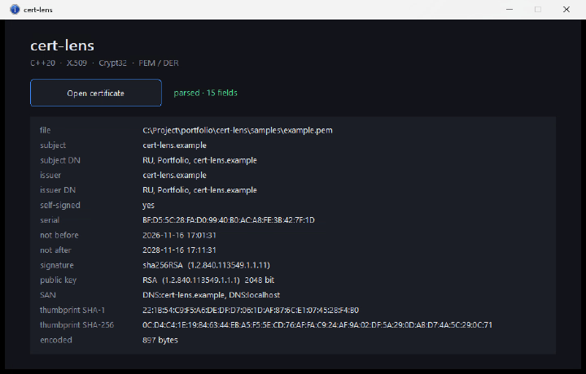

# cert-lens

C++20 Win32 X.509 viewer. Crypt32, no OpenSSL. PEM / DER / CER / CRT. Open or drag-and-drop.

Parse is a static lib (`cert_parse`); the window only paints. Self-signature, validity vs now, key usage, EKU, and basic constraints are real Crypt32 checks — not string dumps.



## interface

Dark Win32 window. One button, one status line, then a key/value table.

```
┌ cert-lens ──────────────────────────────────────┐
│ cert-lens                                       │
│ C++20 · X.509 · Crypt32 · PEM / DER             │
│                                                 │
│ [ Open certificate ]   parsed · N fields        │
│                                                 │
│ file / subject / issuer / DNs                   │
│ self-issued / self-signature / self-signed      │
│ serial, not before / after, validity            │
│ signature, public key, key usage, EKU           │
│ basic constraints, SAN, SHA-1 / SHA-256, size   │
└─────────────────────────────────────────────────┘
```

| control | what it does |
|---|---|
| **Open certificate** | file picker, filter PEM/CER/CRT/DER |
| **drop on the window** | same parse path as Open |
| **status** | `parsed · N fields` (green) or an error (red) |
| **table** | names, self-signature, validity window, KU/EKU, basic constraints, SAN, thumbprints |

`samples/example.pem` is the cert in the screenshot (self-signed RSA-2048, SAN `cert-lens.example` + `localhost`). Not a CA. No university issuer.

## fields

| field | source |
|---|---|
| self-issued | `CertCompareCertificateName` subject vs issuer |
| self-signature | `CryptVerifyCertificateSignatureEx` with the cert's own SPKI |
| self-signed | self-issued **and** signature verifies |
| validity | `CompareFileTime` vs `GetSystemTimeAsFileTime`: `valid` / `not yet valid` / `expired` |
| key usage | `szOID_KEY_USAGE` |
| EKU | `szOID_ENHANCED_KEY_USAGE` |
| basic constraints | `szOID_BASIC_CONSTRAINTS2` (`CA=yes/no`, optional pathLen) |

## build

```
cmake -S . -B build -G "Visual Studio 18 2026" -A x64
cmake --build build --config Release
ctest --test-dir build -C Release --output-on-failure
.\build\Release\cert-lens.exe samples\example.pem
```
